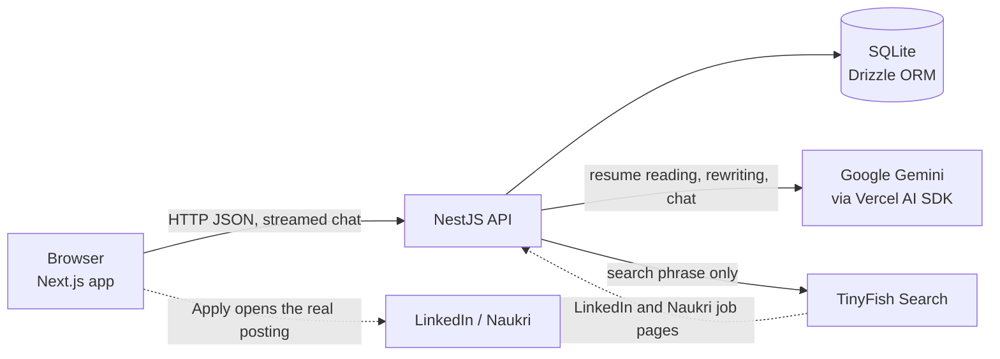
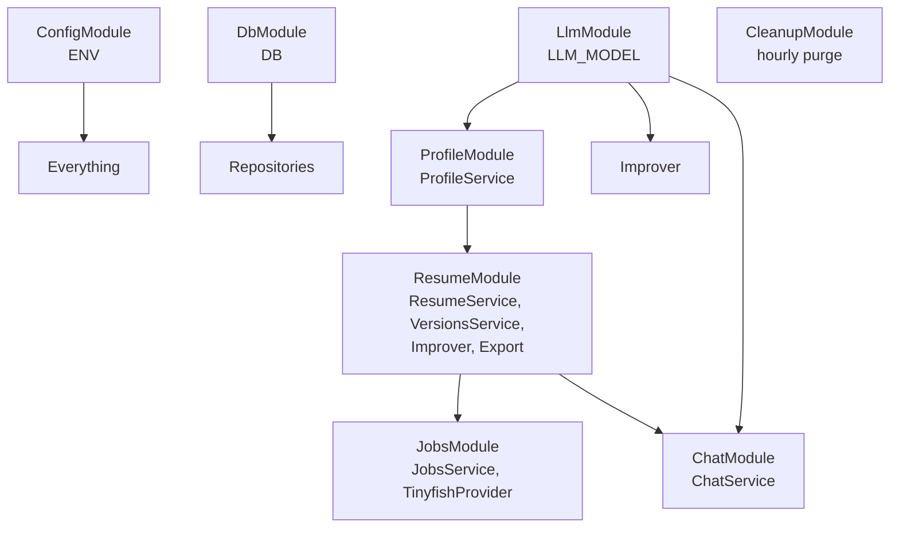

# Architecture overview

Read this first. It explains what the system is made of and where things live. The other files go deeper:

| File | Read it for |
|---|---|
| [flows.md](flows.md) | Step-by-step flows: create a resume, improve, chat, apply chat, job search, cleanup |
| [api.md](api.md) | Every endpoint and what each backend module and function does |
| [ai-and-data.md](ai-and-data.md) | The AI calls and prompts, the resume and profile formats, the database tables |
| [web.md](web.md) | Pages, components, state and what the browser stores |

## What the system does

A user brings a resume (file, pasted text, or rough notes). The system:
1. reads it into a **profile** (name, role, seniority, years, skills, location),
2. rewrites it as an **improved resume**, saved as versions, tailored to a target role if given,
3. lets the user refine it through **chat** or an "extra details" box,
4. exports it as **DOCX or PDF**,
5. searches **LinkedIn and Naukri** for matching jobs and links out to the postings.

There are no user accounts. Each resume has an unguessable UUID that acts as the access key, and everything expires after 7 days by default.

## System map



Responsibilities are kept separate on purpose:

| Concern | Owner |
|---|---|
| Understanding and rewriting the resume, chat | Gemini |
| Finding jobs | TinyFish Search |
| Turning search results into job cards, removing duplicates, scoring | Plain code in the API |
| Storing everything | SQLite file |
| Applying to a job | The user, on the original site. The app never submits anything |

Gemini never browses or searches. TinyFish never receives resume text, only a short search phrase.

## Repository layout

```
apps/api/                NestJS API
  src/
    config/              env loading and validation
    db/                  SQLite connection, migrations, table definitions
    llm/                 Gemini model with fallback chain
    profile/             resume text -> profile (AI)
    resume/              upload, parsing, versions, improve, export
      parsers/           PDF and DOCX to text
      improver/          improve, versions, fact check, text rendering
      export/            DOCX and PDF writers
    jobs/                query building, TinyFish provider, parsing, scoring, cache
    chat/                chat sessions, streaming, apply-to-resume
    cleanup/             hourly expiry job
    common/              AI error filter, time helpers
    health/              health endpoint
  drizzle/               generated SQL migrations (applied on start)
apps/web/                Next.js app
  app/                   pages (/, /studio, /studio/[id], /r/[id])
  features/              upload, studio, chat, jobs, resume components
  components/ui/         shadcn button and tabs, spinner
packages/shared/         Zod schemas and helpers used by API and web
scripts/                 demo seed, TinyFish quality check
docs/                    plan, progress, decisions, this documentation
```

## Backend module map



Config, database and model are global modules. Feature modules inject them by token (`ENV`, `DB`, `LLM_MODEL`) without importing them.

## Layering rules the code follows

- **Controllers are thin.** They validate input (Zod) and call one service method.
- **Services hold the logic** and call other services or repositories.
- **Repositories are the only code that touches the database.** One per table group.
- **Providers sit behind an interface.** The job source is `JobProvider`, so TinyFish can be swapped.
- **Shared types live in `packages/shared`** so API and web agree on shapes.

## Key design ideas

1. **Versions, not edits.** Every improve or apply-chat creates a new row in `resume_versions`. Nothing is overwritten. The page always shows the newest and can compare with the one before it.
2. **The resume body is free-form.** It is a list of sections the AI can add, rename, reorder, split or merge. The renderers (page, DOCX, PDF, text) just walk that list.
3. **Facts are protected, structure is not.** The AI may restructure and re-emphasise anything, but must not invent facts. Numbers that are not in the user's text are flagged.
4. **Chat does not change the resume until applied.** The chat only talks. "Apply" turns the conversation into a new version through the same improve path.
5. **The profile follows the newest resume.** Job search uses a profile rebuilt from the latest version when the user presses "Search jobs with this resume".
6. **Models fail over.** If one Gemini model is out of quota or unavailable, the next in the list is tried.

## Configuration

All settings come from environment variables, validated in `apps/api/src/config/env.ts`.

| Variable | Default | Meaning |
|---|---|---|
| `GEMINI_API_KEY` | none | Required for any AI feature |
| `GEMINI_MODEL` | `gemini-3.5-flash` | Primary model |
| `GEMINI_FALLBACK_MODELS` | `gemini-3.1-flash-lite,gemini-3-flash-preview,gemini-3.6-flash` | Tried in order on 404, 429 or 5xx |
| `TINYFISH_API_KEY` | none | Required for job search |
| `DATABASE_PATH` | `data/app.db` | SQLite file, relative to `apps/api` |
| `RESUME_TTL_HOURS` | `168` | Lifetime of resumes, versions and chats (chat lifetime slides with each message) |
| `JOB_CACHE_TTL_HOURS` | `8` | How long an identical search is served from cache |
| `PORT` | `4000` | API port |
| `WEB_ORIGIN` | `http://localhost:3000` | CORS origin |
| `NEXT_PUBLIC_API_URL` | `http://localhost:4000` | Read by the web app |

The API loads `.env` from `apps/api` or the repository root. Missing keys do not stop the app; features that need them return a clear 503.

## Testing

Vitest, 55 tests in `apps/api/src`:

| Area | What is tested |
|---|---|
| Parsers | Real PDF and DOCX files are generated and read back; scanned, corrupt and unsupported files |
| Jobs | Title parsing on real TinyFish samples, scoring, query building, service behaviour, caching |
| Resume | DOCX and PDF export contents and section order, legacy version conversion, versions, previous version, role memory, fact check |
| Chat | Streaming and saving with a mock model, cross-session isolation, apply, create-from-chat |
| AI | Structured output with a mock model, model fallback |
| Cleanup | Expired rows and their children are removed |

The AI is tested with the SDK's mock model, so tests never call Gemini.
