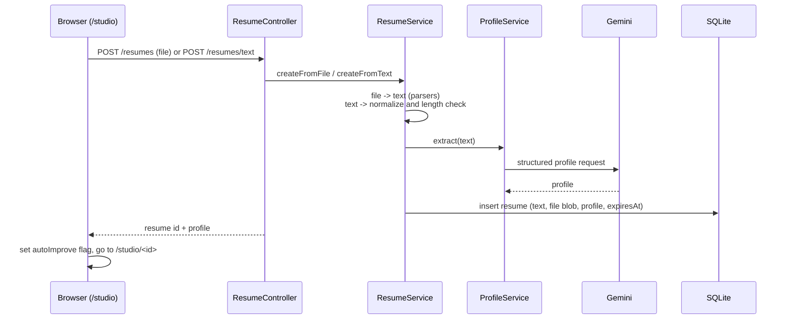
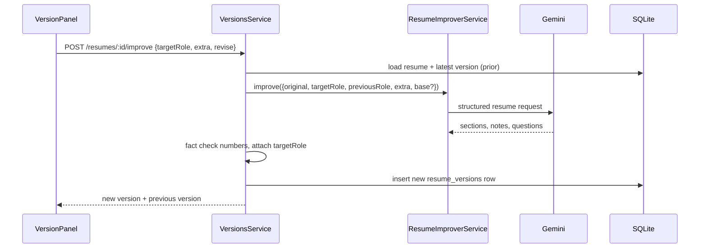
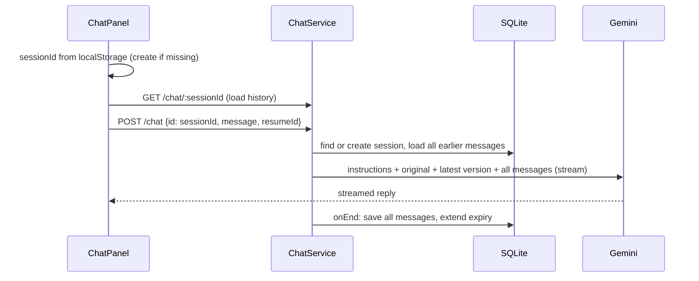
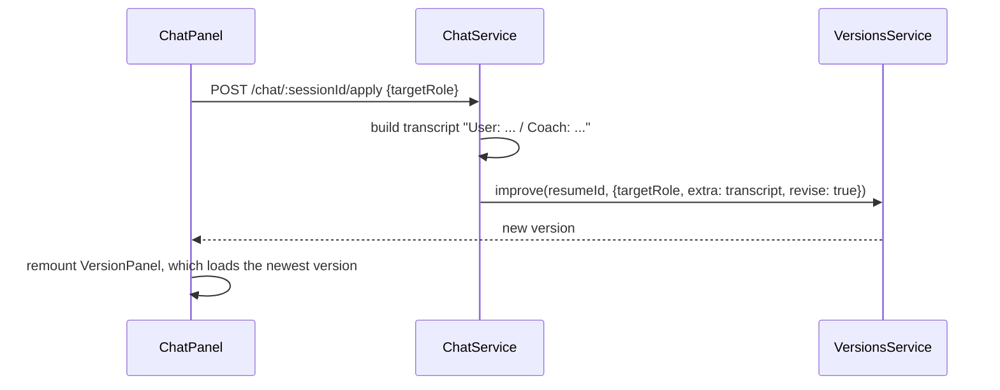
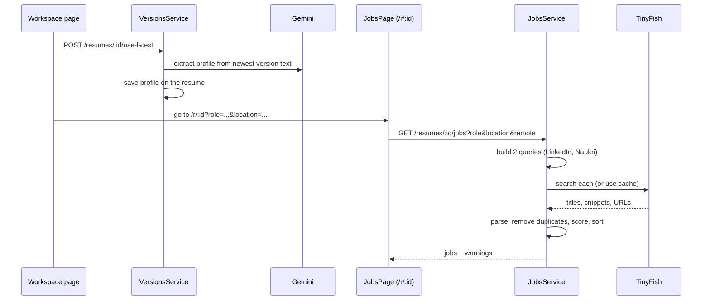
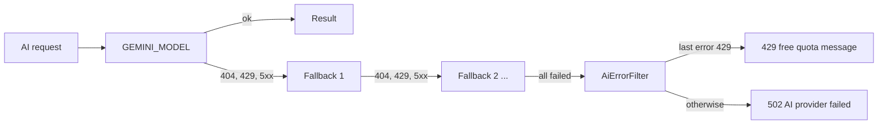

# Flows

Each flow names the browser action, the API calls and what is saved. File names are relative to `apps/api/src` or `apps/web`.

## 1. Create a resume (upload or type)

- **File path:** `parseResumeFile` picks the PDF or DOCX parser by extension or MIME type, normalises whitespace, and rejects text shorter than 80 characters (that is how scanned PDFs are caught).
- **Text path:** 30 to 30,000 characters.
- **Order matters:** the profile is extracted before saving. If Gemini fails, nothing is stored.
- The original text is stored, and for uploads the original file bytes too.

## 2. First improve (automatic) and "Improve again"

- `base` is the latest version, sent only when `revise` is true and a version exists. The AI is then told to revise it instead of starting over.
- `previousRole` is the role the base was tailored for. If it differs from `targetRole`, the AI must redo the tailoring.
- `extra` is free text from the details box (or a chat transcript, see flow 4).
- On the first visit from the start page, the browser sees a sessionStorage flag and calls improve automatically. Later visits do not.
- The UI shows "Tailored for X" from the saved version's role. If the role box differs, the button becomes "Tailor for this role".

## 3. Chat (talking only)

- The session id is made by the browser (`chat:<resumeId>` in localStorage) and never sent to Gemini. It only tells our server which saved messages to load.
- Gemini keeps no memory, so every request carries the whole history.
- The reply is plain text. **The resume does not change.**
- The reply is also saved when the browser disconnects early (`consumeStream`).
- A session stops accepting messages after 200.

## 4. Apply chat to the resume

This is the same `improve` as flow 2. The transcript is passed as the "extra details", with an instruction to apply only what the user asked for or agreed to. Chat always builds on the latest version.

## 5. Download

`GET /resumes/:id/export?format=docx|pdf&versionId=…` loads the version (or the latest), normalises it, and builds the file on the fly with `ResumeExportService`. The file name comes from the resume's name. Nothing is cached.

## 6. Search jobs with this resume

**Job pipeline in detail**
1. `buildQueries` makes one query per site: `site:<scope> [seniority] <role> <top 3 skills> [<years> years] [remote] <location>`.
   - Role and location come from the filters, falling back to the profile.
   - Seniority is added only for intern, junior, senior or lead, and only if the role has no level word.
   - Years are added only when 1 or more.
2. For each query, `JobCacheRepository.get` returns saved hits if they are younger than the cache TTL. Otherwise `TinyfishProvider.search` calls TinyFish and the hits are cached.
3. Queries run in parallel and failures are isolated. One failing site becomes a warning. If all fail, the API returns 503 (key missing) or 502.
4. `parseHit` keeps only real job pages (LinkedIn `/jobs/view`, Naukri `/job-listings`), and extracts title, company and location with per-site patterns. The apply URL has its tracking parameters removed.
5. `dedupe` drops repeats by URL and by title plus company.
6. `scoreJob` ranks by skills (60%) and role words in the title (40%), using the profile's top 10 skills.
7. The result is sorted by score, highest first.

## 7. Expiry and cleanup

- Every resume has `expiresAt` (created + `RESUME_TTL_HOURS`). Reads treat an expired resume as missing even before it is deleted.
- Chat sessions have their own `expiresAt`, pushed forward on every message.
- `CleanupService` runs at startup and every hour. It deletes expired resumes (versions and linked chats go with them through foreign-key cascade), expired sessions, and job cache rows older than the cache TTL.

## 8. Model fallback and errors

Other errors (for example a 400 from the provider) are not retried on another model. The first failure is reported.
