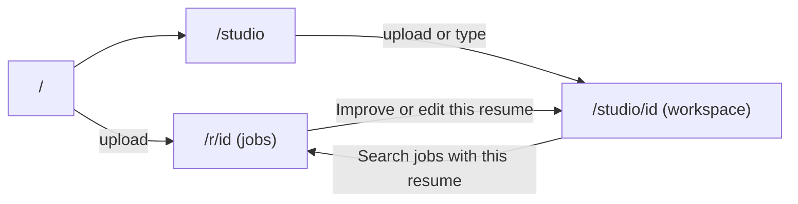

# Web app

Next.js 16 (App Router), React 19, Tailwind 4, shadcn/ui. Strictly black and white, Inter font. All data pages are client components that call the API directly.

## Pages

| Route | File | Purpose |
|---|---|---|
| `/` | `app/page.tsx` | Quick upload (goes to the jobs page) and a button to the studio |
| `/studio` | `app/studio/page.tsx` | One page to upload a file, or type or paste a resume or notes. Goes to the workspace |
| `/studio/[resumeId]` | `app/studio/[resumeId]/page.tsx` | Workspace: role and location bar, chat, improved resume, downloads |
| `/r/[resumeId]` | `app/r/[resumeId]/page.tsx` | Profile summary and matching jobs |

## Components

| Component | File | Responsibility |
|---|---|---|
| `UploadForm` | `features/upload/upload-form.tsx` | Drop zone and optional text box. Posts a file or text, then navigates to `destination(id)`. `inlineText` shows the text box always (studio); otherwise it hides behind "Paste text instead" (home). `onCreated` lets the studio set the auto-improve flag |
| `VersionPanel` | `features/studio/version-panel.tsx` | Everything about the resume document: loads original and latest version, runs improve, shows tailored-for label, Improved and Before tabs, downloads, questions, change notes, loading states |
| `ResumeDocument` | `features/studio/resume-document.tsx` | Renders a resume by walking its sections |
| `ChatPanel` | `features/chat/chat-panel.tsx` | Session id, history load, streaming chat, "Apply this chat" button |
| `JobsPanel`, `JobCard` | `features/jobs/` | Filters, search call, job cards with Apply links |
| `ProfileSummary` | `features/resume/profile-summary.tsx` | Name, headline, skills, expiry date |
| `Spinner`, `LoadingBlock` | `components/ui/spinner.tsx` | Loading indicators |
| `lib/api.ts` | | `api()` fetch wrapper: base URL from `NEXT_PUBLIC_API_URL`, throws an `Error` whose message is the server's message |

## The workspace in detail (`/studio/[resumeId]`)

State held by the page:
- `resume`: profile loaded from the API.
- `role`, `location`: the "Jobs you want to find" boxes. Start from `localStorage` (`searchPrefs:<id>`) or the profile's headline and city.
- `versionTick`: a counter used as the `key` of `VersionPanel`. Changing it remounts the panel so it reloads the newest version (done after "Apply chat").
- `applying`: true while a chat is being applied, so the panel shows a loader.
- `searching`, `searchError`: for the search button.

Behaviour:
- **Search jobs button:** saves the role and location, calls `POST /resumes/:id/use-latest`, then navigates to `/r/:id?role=…&location=…`. If the call fails, the page stays and shows the error.
- **Role box:** shared by three things: the rewrite (`targetRole`), apply chat (`targetRole`) and job search.
- **VersionPanel label:** compares the role the current version was tailored for (stored on the version) with the box. Same: "Tailored for X". Different: "Tailored for X. Press the button to tailor it for Y", and the button reads "Tailor for this role".
- **Auto improve:** the start page sets `sessionStorage["autoImprove:<id>"]`. On first load with no version, `VersionPanel` reads and clears it and runs improve. Reloads and revisits do not.
- **Loading:** the panel shows a labelled loader while loading, improving or applying a chat, and only shows "No improved version yet" after the auto-improve check has run, so there is no misleading flash.

## Chat panel in detail

1. `useSessionId(storageKey)` reads `localStorage[storageKey]` (`chat:<resumeId>`), creating a UUID if absent. If storage is blocked it uses an unsaved id.
2. It then calls `GET /chat/:sessionId` and starts `useChat` with those messages.
3. The transport posts only the newest message, with the session id and resume id. The server rebuilds the history.
4. "Apply this chat to my resume" appears once the user has sent a message. It posts the role, then calls `onApplied` so the page reloads the version panel.
5. The session id is never reset by the app. A new browser or cleared storage starts a new chat. Server-side sessions expire after seven days of silence.

## Jobs page (`/r/[resumeId]`)

- Reads `role` and `location` from the query string, falling back to the profile. It passes them to `JobsPanel` as defaults.
- `JobsPanel` loads once on arrival and again whenever the user presses Search with changed filters. It shows skeletons while loading, warnings from the API (for example one site failing), and an empty state.
- Each `JobCard` shows title, company and location, a snippet, the source, the match percentage and an Apply link that opens the original posting in a new tab.

## What the browser stores

| Place | Key | Value | Purpose |
|---|---|---|---|
| localStorage | `chat:<resumeId>` | session UUID | Find the saved chat |
| localStorage | `searchPrefs:<resumeId>` | `{role, location}` | Remember the job bar |
| sessionStorage | `autoImprove:<resumeId>` | `"1"` | Run the first improve once |

All reads and writes are wrapped in try/catch, so the app works when storage is blocked.

## Styling and accessibility

- Tokens are in `app/globals.css` and are grayscale only (no red or blue anywhere).
- Hairline borders, small radius, no shadows. Content width about 720 px for reading and 960 to 1100 px for the workspace.
- Loaders use `role="status"`, errors use `role="alert"`, buttons have visible focus rings, and the compare toggles expose `aria-pressed`.
